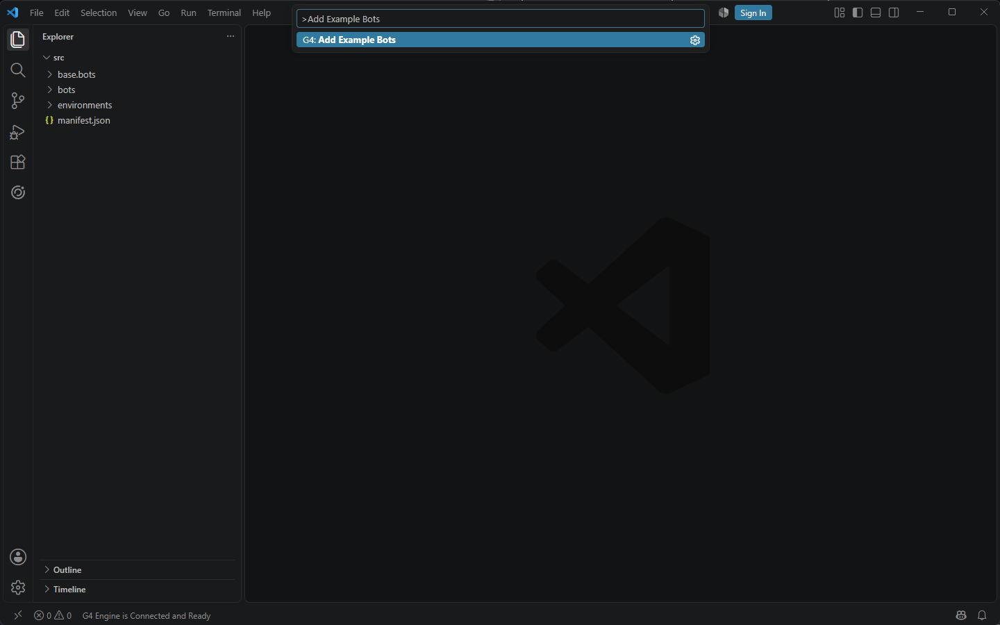
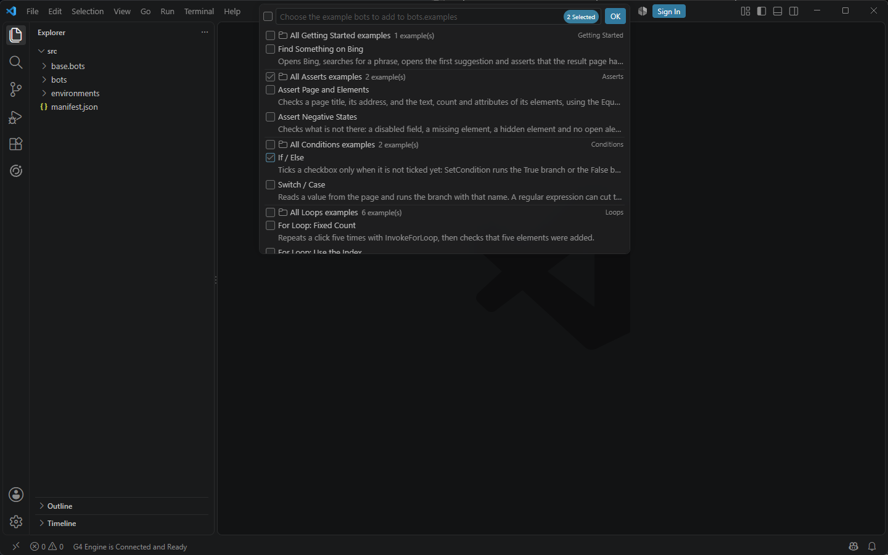
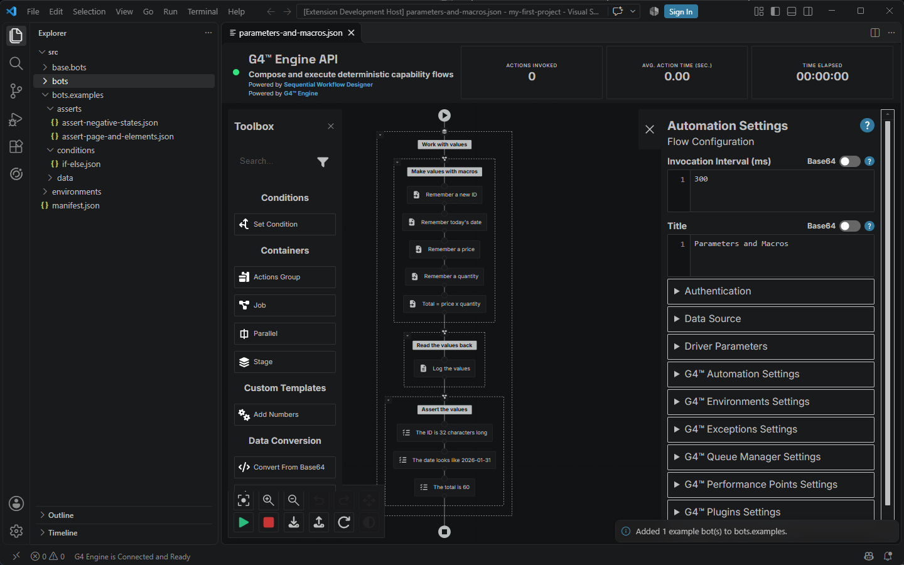
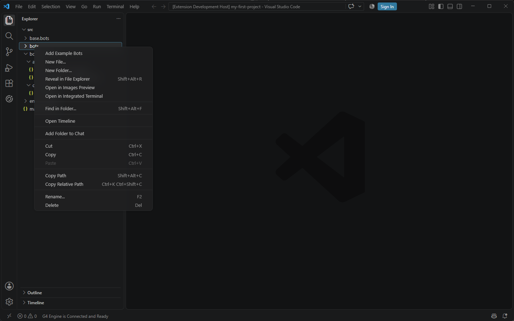
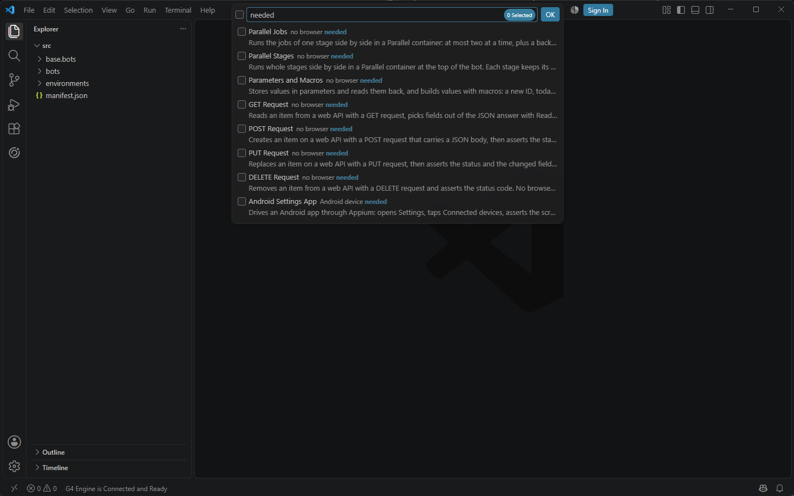

# Example Bots: G4 Studio

[⬅ Back to the learning paths](g4-learning.md)

G4 Studio ships with example bots: small, complete bots that each show one thing, such as an assert, a loop or an
API call. A new project starts without them. The command **Add Example Bots** (id `Add-ExampleBots`) lists the
examples and adds the ones you pick to your project.

This page explains the command. It does not list the examples, because the list changes from release to release. The
picker of the command always shows the current list, with a description of each example.

Jump to a part:

- [What the command does](#what-the-command-does)
- [Add examples from the Command Palette](#add-examples-from-the-command-palette)
- [Add examples from the Explorer](#add-examples-from-the-explorer)
- [Read the picker](#read-the-picker)
- [Open and run an example](#open-and-run-an-example)
- [Add an example again](#add-an-example-again)
- [Skip the picker](#skip-the-picker)
- [Messages](#messages)
- [Check your work](#check-your-work)

---

## What the command does

The command needs a project folder open in VS Code: the folder that holds `manifest.json`. It does not need the Hub.
You need the Hub only when you run an example.

| Subject | What happens |
| --- | --- |
| Where the files go | Each example is written to `bots.examples/<group>/<name>.json` in the project folder, beside `bots`. The command creates `bots.examples` and the group folder when they are missing. |
| Driver settings | An example that drives a browser gets the `driverParameters` of `base.bots/chrome-automation-base.json`. A Windows desktop example gets those of `base.bots/uia-automation-base.json`. It then runs against the same sandbox as your other bots. Every other example keeps the settings it ships with. |
| Files that already exist | The command asks before it replaces an example that is already in the project. See [Add an example again](#add-an-example-again). |
| Extra files | A few examples need one more file, such as an environment. The command writes that file to its own place, such as the `environments` folder. It never replaces a file that is already there. |
| One example | When you add exactly one example, it opens in the workflow editor. |

Your own bots stay in `bots`. Nothing in `bots` is read or changed by this command.

---

## Add examples from the Command Palette

1. Press `Ctrl+Shift+P` to open the Command Palette.
2. Type `Add Example Bots` and press `Enter`.

    

3. Tick the examples you want. A row that starts with **All** adds every example of its group.

    

4. Click **OK**, or press `Enter`.
    1. A notification tells you how many examples were added.
    2. The `bots.examples` folder appears in the Explorer, with one folder for each group.
    3. When you added one example, it opens in the workflow editor.

    

The picker stays open when you click somewhere else. Press `Esc` to close it without adding anything.

---

## Add examples from the Explorer

1. In the Explorer, right-click the `bots` folder or the `bots.examples` folder.
2. Click **Add Example Bots**.

    

3. Pick the examples, as in [Add examples from the Command Palette](#add-examples-from-the-command-palette).

The examples go to `bots.examples`, whichever of the two folders you right-clicked.

---

## Read the picker

Each example is one row: its name, a short tag, and under it a description of what the example does.

| Part of the picker | What it tells you |
| --- | --- |
| A group heading, such as **Loops** | The topic of the rows below it. It is also the name of the folder the examples go to. |
| A row that starts with **All** | Adds the whole group. The number beside it is the number of examples in the group. |
| The tag **no browser needed** | The example runs without a browser or an app. It is the quickest kind to try. |
| The tag **Windows only** | The example drives a Windows desktop app. It is listed only on Windows. |
| The tag **Android device needed** | The example needs an Android device or emulator and an Appium server. |
| No tag | The example drives a browser. |

Type in the box at the top to search. The search looks in the names, the tags and the descriptions. For example,
type `needed` to see every example that carries a tag with that word.



---

## Open and run an example

1. In the Explorer, open `bots.examples` and the group folder.
2. Right-click the example and click **Open in Workflow Editor**.
3. Run it from the designer. See [Run from the designer](work-in-the-workflow-editor/04-run-from-the-designer.md).

Each step of an example has a name that says what the step does. The examples check their own results where they
can, so the report shows whether a run worked.

Keep these points in mind:

- An example is an ordinary bot file. Change it as you like. To keep your version safe, see
  [Add an example again](#add-an-example-again).
- **Open in Flow Publisher** and **Open in Template Publisher** work only on bots below a `bots` folder. To publish
  an example, copy it into `bots` first.
- An example that came with an environment file reads its values from the Hub. Send the file to the Hub first, with
  the command **Update or Create Environment Variables**. See
  [Push with Update-Environment](environments-and-parameters/03-push-with-update-environment.md).
- An Android example needs an Appium server and a device. Start an emulator on port `5580` when the UIA driver
  server runs on the same machine. See [Record an Android app](record-an-app/08-record-an-android-app.md).
- An example that saves data names a file without a folder. The Hub writes such a file to the folder it runs in. Set
  a full path in the data collector of the step to choose another place.

---

## Add an example again

When an example you picked is already in `bots.examples`, the command asks what to do with it:

| Answer | What happens |
| --- | --- |
| **Overwrite** | Replaces this example with the shipped one. Your changes to it are lost. |
| **Overwrite All** | Replaces this example and every other one that already exists, without asking again. |
| **Skip** | Leaves this example as it is. |
| **Skip All** | Leaves this example and every other one that already exists, without asking again. |

Closing the dialog counts as **Skip**.

To keep a changed example and also get the shipped one back:

1. Rename your changed file, or move it to `bots`.
2. Run **Add Example Bots** and pick the example again.

---

## Skip the picker

The command accepts the examples to add as its argument. With an argument it adds them at once and shows no picker.
Use this for a keyboard shortcut or from another extension.

An example is named by its id: the group folder and the file name, without `.json`. The example at
`bots.examples/api/get-request.json` has the id `api/get-request`.

| Argument | Example |
| --- | --- |
| One id | `"api/get-request"` |
| A list of ids | `["api/get-request", "api/post-request"]` |
| An object with `ids` | `{ "ids": ["api/get-request"] }` |

This entry of `keybindings.json` adds one example with a key press:

```json
{
    "key": "ctrl+alt+e",
    "command": "Add-ExampleBots",
    "args": "api/get-request"
}
```

An id that matches no example is reported in a warning, and the other ids are still added.

---

## Messages

| Message | When you see it | What to do |
| --- | --- | --- |
| `Added 3 example bot(s) to bots.examples.` | The examples were written. | Nothing. Open them from the Explorer. |
| `... Skipped 1.` at the end of the message above | One example already existed and you chose to skip it, or its file could not be written. | For a file that could not be written, read the reason in the **Output** panel. |
| `... Also added environments/<name>.json.` at the end of the message above | An example brought an extra file. | Send an environment file to the Hub before you run the example. |
| `Open a G4 project folder first, then add example bots.` | No folder is open in VS Code. | Open your project folder, then run the command again. |
| `No example bots are available for this platform.` | No shipped example runs on this operating system. | Not expected: most shipped examples run on every operating system. |
| `Unknown example bot(s): <ids>.` | The command got an id that matches no example. | Check the id against the folder and file name of the example. |
| `"<name>" keeps its shipped driver settings: <file> is missing or not a bot.` in the **Output** panel | The project has no base bot for the driver of this example. | Open the example and set its driver settings yourself. |

---

## Check your work

- [ ] The Command Palette lists **Add Example Bots**.
- [ ] The picker shows groups, and a description under each example.
- [ ] After you click **OK**, the Explorer shows `bots.examples` with a folder for each group you picked from.
- [ ] A single added example opens in the workflow editor.
- [ ] You can say what **Overwrite All** and **Skip All** do.
